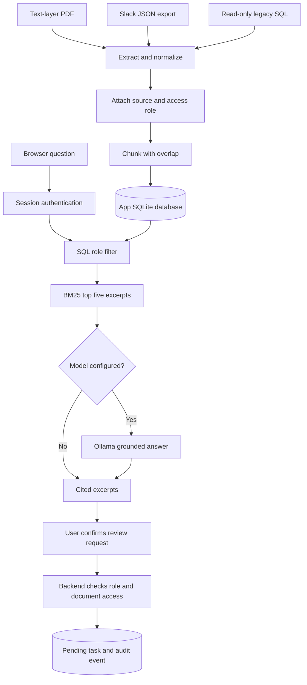

# Architecture and code walkthrough

## End-to-end flow

## File map

| File | Responsibility | What to study |
|---|---|---|
| `src/server.js` | HTTP routing, body limits, sessions, role gates | Request lifecycle and trust boundary |
| `src/core.js` | Schema, password/session handling, ingestion, BM25, actions | SQL, transactions, RBAC, idempotency |
| `src/connectors.js` | PDF, Slack, ERP adapters | Turning different source formats into text |
| `src/answer.js` | Optional Ollama generation with fallback | RAG context construction and failure handling |
| `public/app.js` | Browser forms and API rendering | Fetch, asynchronous operations, safe text rendering |
| `test/*.test.js` | Functional/security regression tests | Test forbidden paths as well as success |
| `compose.yaml` | Deployment configuration | Environment variables, ports, volume |

## Storage model

`users` holds username, role, salt and password hash. `sessions` holds token hashes, user IDs and expiry timestamps. `documents` holds metadata and a deduplication fingerprint. `chunks` holds text and positions. `tasks` records pending invoice reviews. `audit` records actor ID, event name, target ID and timestamp.

The original uploaded binary is not retained. Extracted text is retained and may still contain personal information. Query text and answer content are not written into the audit table. Audit metadata can still be personal data.

Fingerprints include source type, role, title and cleaned text. Identical values reuse the existing document. Different role/title/content creates a separate document. This is exact deduplication, not fuzzy matching or source-version reconciliation.

## Trace a concrete request

1. `finance` signs in. Backend derives and compares the password hash, creates a token, and sets an HttpOnly session cookie.
2. Browser posts `{"query":"Acme overdue"}` to `/api/ask`.
3. Backend hashes the cookie token and loads an unexpired session and role from the database.
4. `search()` selects only employee and finance chunks through parameterized SQL.
5. BM25 scores this authorized corpus and returns five matching chunks at most.
6. `answerQuestion()` returns extractive mode, or supplies those excerpts to the configured Ollama endpoint.
7. UI renders text using `textContent`, not HTML interpolation. Uploaded markup is displayed as text.
8. User confirms a review. A separate API checks the role and current document visibility again before creating a task.

Changing a document ID in the request does not bypass the permission check. LLM output is never used as SQL or executable browser HTML.

## Deliberate tradeoffs

- Node's built-in HTTP and SQLite modules keep the backend small. Routing/validation are explicit; a larger service would benefit from a framework and schema validation library.
- Synchronous SQLite/scrypt simplify the demo but block the event loop. Production needs worker/off-thread work, concurrency limits and appropriate storage.
- BM25 scans authorized chunks on every request. Suitable for a small demo, not a large enterprise corpus. Add indexed lexical/vector retrieval with permission filtering.
- A single access role is assigned to each document. The uploader must correctly classify Slack exports; source permissions are not imported automatically.
- PDF text comes from a parser, not OCR. Tables and complex page layouts can lose structure.
- The action creates a pending review only. A full approval state machine and ERP write-back are separate work.
- The generation timeout is 45 seconds. Ollama is optional and failure preserves evidence search.

## Source contracts

ERP adapter expects `invoices(id, vendor, amount_cents, currency, status, due_date)`. It reads at most 1,000 rows from the server-controlled legacy database. The normal and demo servers seed two fictional invoices.

Slack accepts an array of messages or an object with a `messages` array. Each accepted message has string `text`; `user` and `ts` are retained as context. Maximum 5,000 messages; full Slack ZIP exports, attachments, and thread expansion are not implemented.

PDF uploads are base64 inside JSON, which adds roughly one-third transport overhead. Browser limits files to 5 MB; server limits request bodies to 8 MB and extracted text to 500,000 characters. Production should use streamed multipart uploads and isolated parsing workers.
